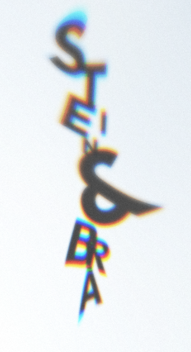

# OptikLab



Estúdio generativo de tipografia experimental, shaders ópticos em tempo real (WebGL2) e composição visual.

## Recursos

- **Persona Optical**: Dispersão tipográfica orgânica com controle de porcentagem de desfoque e múltiplas zonas focais (radial e faixa linear).
- **Make Some Noise**: Feixes luminosos direcionais e grão estocástico de alto contraste.
- **Shapes Warp**: Distorção líquida contínua com separação cromática RGB e brilho especular.
- **Tate Halftone**: Fusão orgânica de tinta (Ink Melt) e retícula halftone anti-aliased.
- **Edição Direta no Canvas**: Mova e redimensione caractere por caractere, mova blocos de texto e posicione zonas de desfoque diretamente sobre a arte.
- **Google Fonts & Mídias**: Carregue qualquer fonte do Google Fonts ou faça upload de imagens e vídeos.
- **Exportação em Alta Resolução**: Exporte imagens PNG/JPEG até **4K (3840p)** e vídeos animados em `1080p`, `2K` ou `4K` (`30` / `60 FPS`).

## Desenvolvimento

```bash
npm install
npm run dev
```

## Build de Produção

```bash
npm run build
```
